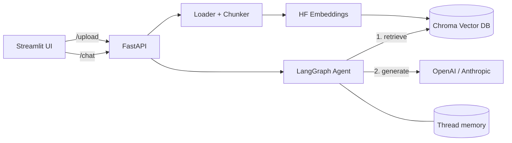

# RAG Chatbot over Your Documents

A retrieval-augmented chatbot built with **LangGraph**, **FastAPI**, **Chroma** (vector DB) and **Hugging Face embeddings**. Upload PDFs, ask questions, get answers with source citations and conversation memory. Works with OpenAI or Anthropic models by changing one environment variable.

## Architecture



**Flow:** documents are split into chunks, embedded locally with `all-MiniLM-L6-v2`, and stored in Chroma. For each question the graph retrieves the top-k similar chunks, then asks the LLM to answer using only that context and cite sources. A per-thread checkpointer keeps the chat history.

## Project structure

```
rag-chatbot/
  app/
    config.py          settings from .env
    llm.py             OpenAI / Anthropic model factory
    vectorstore.py     Chroma + Hugging Face embeddings
    ingest.py          load, chunk, store (also a CLI)
    graph.py           LangGraph: retrieve, then generate, with memory
    main.py            FastAPI endpoints
  ui/streamlit_app.py  chat UI
  tests/               pytest (no API keys needed)
  data/sample_docs/    example document to try
  Dockerfile
  docker-compose.yml
  requirements.txt
  .env.example
```

## Quick start

```bash
python -m venv .venv && source .venv/bin/activate
pip install -r requirements.txt
cp .env.example .env          # add your API key, pick LLM_PROVIDER

python -m app.ingest data/sample_docs     # index the sample doc
uvicorn app.main:app --reload             # API on :8000 (docs at /docs)
streamlit run ui/streamlit_app.py         # UI on :8501
```

### Docker

```bash
cp .env.example .env
docker compose up --build     # API :8000, UI :8501
```

## API

| Endpoint | Method | Purpose |
|---|---|---|
| `/health` | GET | status, provider, number of indexed chunks |
| `/upload` | POST | upload a PDF/TXT/MD and index it |
| `/chat` | POST | `{"question": "...", "thread_id": "abc"}` returns answer + sources |

## Switching models

Set `LLM_PROVIDER=anthropic` or `openai` in `.env`. Nothing else changes.

## LangSmith tracing (optional)

Set `LANGSMITH_TRACING=true` and `LANGSMITH_API_KEY` in `.env` to trace every retrieval and generation.

## Tests

```bash
pytest
```

## What I learned / next steps

- Chunk size and overlap noticeably change answer quality; tune with an eval set.
- Next: add a LangSmith evaluation set, a reranker, and a human-approval node for sensitive questions.

*(Add a demo GIF here: `docs/demo.gif`)*
